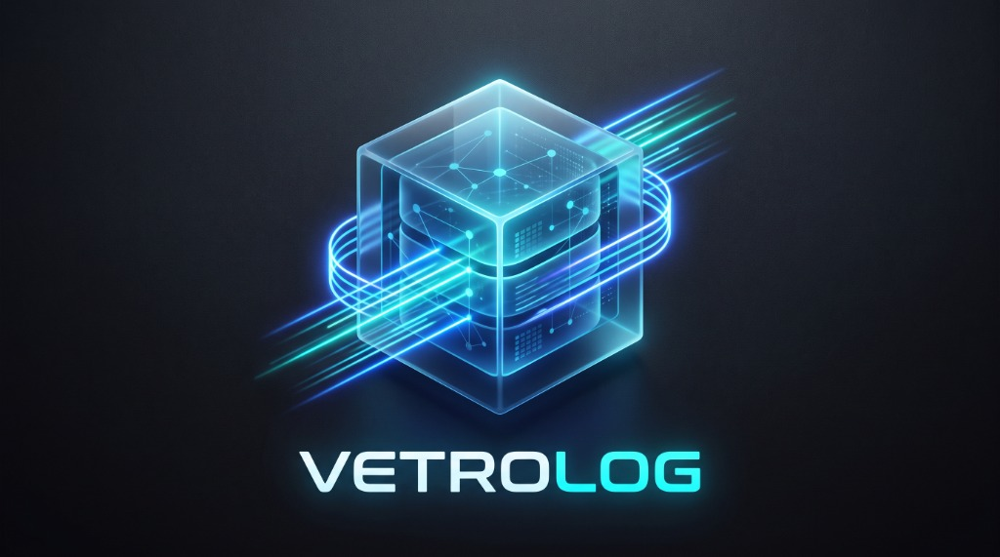

<div align="center">
  
  
  <p><strong>High-Performance Desktop Database Inspector for Mobile Apps (Flutter, Android, iOS, React Native)</strong></p>
  
  <p>
    
    
    
    
    
  </p>
</div>

---

## 🌟 Overview

**VetroLog** is a modern, cross-platform desktop application designed to inspect, query, and edit mobile local databases (SQLite, Hive, SharedPreferences) in real time.

- **Zero-Code ADB Native Bridge**: Inspect SQLite databases (`.db`) and SharedPreferences directly from physical Android devices and emulators over ADB without writing a single line of client code in your Flutter or Android project.
- **WebSocket Live Stream Mode**: Real-time mutation streaming for Flutter, Kotlin, Swift, and React Native apps.
- **Pure-Go SQLite Engine**: Query, filter, and edit records with automatic write-back sync to the phone sandbox.
- **Dark Glassmorphic UI**: High-contrast, sortable, paginated DataGrid with SQL Query Editor and Mutation Console.

---

## 🚀 Quick Start

### 1. Run Development Server

```bash
# Start Wails desktop app in dev mode
wails dev
```

### 2. Inspect Over ADB (Zero Code Required)

1. Connect your Android device via USB (with **USB Debugging** enabled).
2. Run your Flutter app in debug mode (`flutter run`).
3. In VetroLog's top header, select your device and app package from the **ADB dropdown**.
4. All SQLite databases (`databases/`, `app_flutter/`) and SharedPreferences load automatically!

---

## 📱 Mobile Client SDKs (Optional WebSocket Streaming)

If you wish to stream live in-memory mutations over WebSockets, lightweight client helpers are provided in `clients/`:

- [Flutter Client](clients/flutter/)
- [Android Kotlin Client](clients/android-kotlin/)
- [iOS Swift Client](clients/ios-swift/)
- [React Native Client](clients/react-native/)
