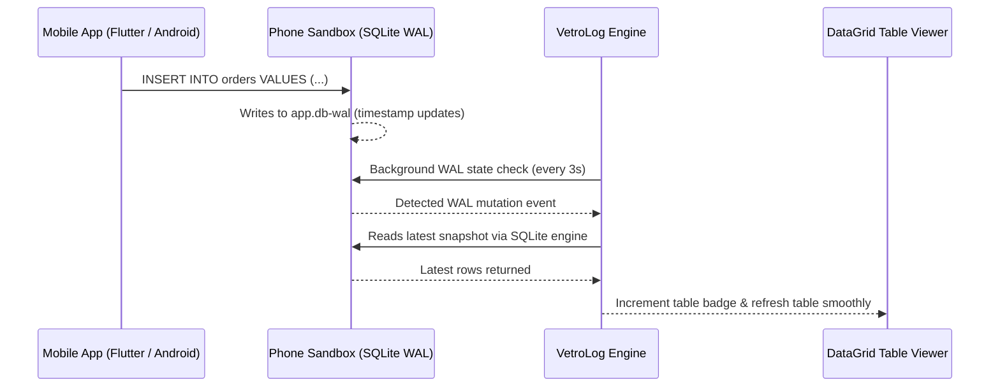

Modern mobile applications (Flutter `sqflite`, Android `Room`, iOS `GRDB`) enable SQLite **WAL (Write-Ahead Logging)** mode by default for performance and concurrency.

Understanding how WAL works is key to understanding why VetroLog delivers true live synchronization while older inspection tools fail.

---

## 💡 The Problem with Traditional Tools in WAL Mode

In SQLite WAL mode:
* Reads and writes happen concurrently.
* New inserts, updates, and deletes are **not** written immediately into the main `.db` file.
* Instead, mutations are written into a companion **`-wal` (Write-Ahead Log)** file, coordinated by an index in a **`-shm` (Shared Memory)** file:

```
databases/
├── app_user_0.db          <-- Base database (can remain stale for hours)
├── app_user_0.db-wal      <-- Active live mutations written by the phone
└── app_user_0.db-shm      <-- Shared memory index
```

If a tool only reads `app_user_0.db`, it will miss recent transactions!

---

## ⚡ How VetroLog Achieves Real-Time Sync

VetroLog monitors all three files (`.db`, `.db-wal`, and `.db-shm`) simultaneously inside the mobile app's private sandbox:




1. **Lightweight Timestamp Monitoring**: VetroLog checks the modification timestamp and byte size of the `.db-wal` file.
2. **Zero Mobile CPU Impact**: The check is extremely lightweight, requiring zero CPU overhead or battery drain on the mobile device.
3. **Automatic Seamless Refresh**: When you trigger an action in your mobile app (e.g. submitting a form, checking off a todo item, adding an item to cart), VetroLog detects the WAL change and updates the active table view **instantly without requiring a manual page refresh**.

---

## ⏸️ Live Updates Toggle: ON vs OFF

In the DataGrid toolbar, you will find the **Live Updates** switch:

* **`🟢 Live Updates: ON` (Default)**: VetroLog actively syncs every new mutation from your mobile device to your desktop screen in real time.
* **`⚪ Live Updates: OFF` (Paused)**: Pauses live synchronization. This is useful when you want to examine or analyze a frozen snapshot of table records while testing high-throughput background operations on the phone.

---

## Next Steps

* Discover how to edit and write data back to your phone in **[Bidirectional Data Editing](/data-editing/)**.
* Learn how to query your data in the **[SQL Playground](/sql-playground/overview/)**.
