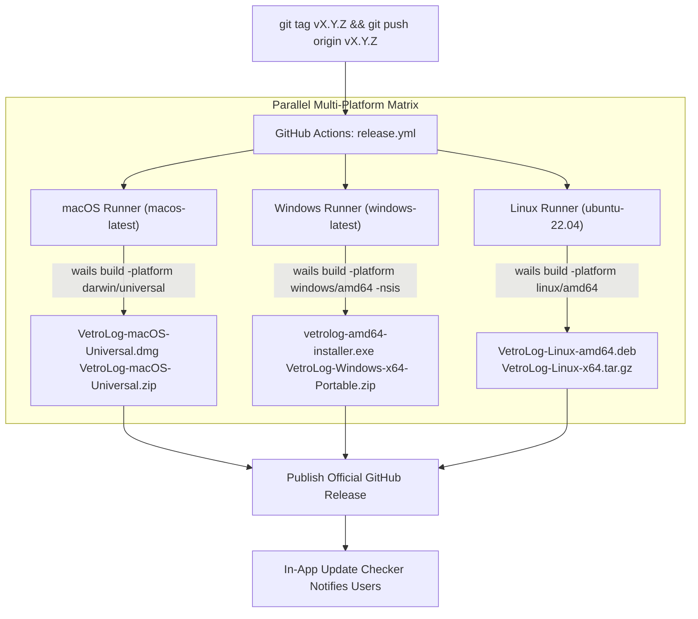

VetroLog uses **GitHub Actions** to fully automate cross-platform compilation, packaging, and distribution across macOS, Windows, and Linux.

---

## 🏗️ Release Pipeline Architecture

Whenever a semantic version tag (e.g. `v1.2.0`) is pushed to GitHub, [`.github/workflows/release.yml`](https://github.com/Tanvirul-swe/vetrolog/blob/main/.github/workflows/release.yml) executes a 3-way parallel build matrix:



---

## 📦 Build Matrix Artifacts

### 1. macOS Universal (`macos-latest`)
* **Universal Fat Binary**: Contains machine slices for both **Apple Silicon (M1/M2/M3/M4)** and **Intel x86_64**.
* **DMG Package**: Built with `create-dmg` to provide an intuitive drag-to-Applications installer.
* **ZIP Archive**: Built with `ditto` for portable unzipping.

### 2. Windows x64 (`windows-latest`)
* **NSIS Installer**: `vetrolog-amd64-installer.exe` with guided installation wizard.
* **Portable Archive**: `VetroLog-Windows-x64-Portable.zip` ready to extract and run anywhere.

### 3. Linux x64 (`ubuntu-22.04`)
* **Debian / Ubuntu Package**: `VetroLog-Linux-amd64.deb` with `.desktop` menu entry and 512x512 app icon.
* **Tarball**: `VetroLog-Linux-x64.tar.gz` for Arch, Fedora, openSUSE, and other distributions.

---

## 🔔 In-App Version Checker Mechanics

VetroLog includes a lightweight client-side update checker (`useUpdateChecker.ts`):

1. On launch, the frontend queries:
   ```http
   GET https://api.github.com/repos/Tanvirul-swe/vetrolog/releases/latest
   ```
2. Compares the latest published `tag_name` (e.g. `v1.2.0`) against the app's internal `CURRENT_VERSION`.
3. If an update is detected, the top header badge pulses with an amber indicator:
   ```
   [ ✨ Update v1.2.0 ↗ ]
   ```
4. Clicking the badge opens the GitHub Releases download page in the user's default browser.

---

## 🚀 How to Publish a New Release

To release a new version of VetroLog:

1. Update `CURRENT_VERSION` in `frontend/src/features/updater/useUpdateChecker.ts`.
2. Commit and push changes to `main`:
   ```bash
   git add -A
   git commit -m "chore: bump version to v1.2.0"
   git push origin main
   ```
3. Create and push an annotated Git tag:
   ```bash
   git tag -a v1.2.0 -m "Release v1.2.0: Multi-tab Playground and Gemini 2.5 AI"
   git push origin v1.2.0
   ```
4. GitHub Actions will build all 6 platform packages and publish the release automatically!

---

## Next Steps

* Check out **[Common Issues](/vetrolog/troubleshooting/common-issues/)** if you run into any setup problems.
* Browse the **[FAQ](/vetrolog/troubleshooting/faq/)**.
