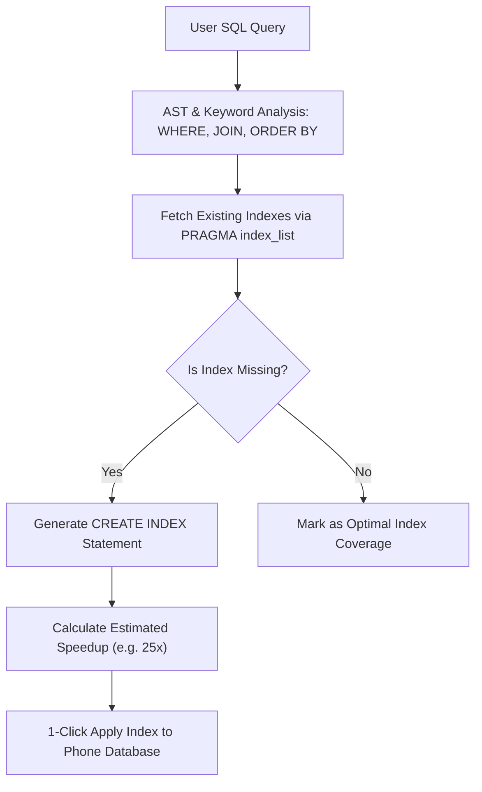

Slow mobile database queries usually stem from missing indexes on frequently filtered or joined columns. VetroLog's **Index Advisor** analyzes your queries in real time and generates optimal SQLite indexes with a single click.

---

## ⚡ How Index Advisor Works



1. **Query Analysis**:
   * Inspects `WHERE` clauses (equality filters `status = 'ACTIVE'`, range filters `created_at > ?`).
   * Inspects `JOIN` conditions (`ON f._id = p.farmer_id`).
   * Inspects `ORDER BY` and `GROUP BY` targets.
2. **Catalog Cross-Referencing**:
   * Inspects existing database indexes using SQLite's `PRAGMA index_list` and `PRAGMA index_info`.
   * Ignores columns that are already indexed or covered by Primary Keys.
3. **Composite Index Recommendations**:
   * When multiple columns are filtered together, suggests compound indexes ordered by equality columns first, followed by range/sort columns.

---

## 🎯 1-Click Index Application

When a missing index is detected:
1. Switch to the **Index Advisor** tab in the bottom panel.
2. Review the recommended statement:
   ```sql
   CREATE INDEX IF NOT EXISTS idx_farming_practices_farmer_id 
   ON farming_practices(farmer_id);
   ```
3. Check the heuristic explanation and estimated performance gain (e.g. `~20x - 80x speedup`).
4. Click **Apply Index**:
   * VetroLog executes the `CREATE INDEX` statement directly on the mobile device.
   * The sidebar schema tree automatically updates to reflect the new index.
   * Re-running the query now converts the high-cost `SCAN` node into an optimal `SEARCH ... USING INDEX` node!


---

## 💡 Best Practices for Mobile SQLite Indexing

* **Index Selective Columns**: Add indexes to columns with high cardinality (e.g. `uuid`, `email`, foreign keys).
* **Avoid Over-Indexing**: Every index consumes additional disk space and slightly slows down `INSERT` operations. VetroLog advises creating only indexes that genuinely benefit frequent read paths.

---

## Next Steps

* Verify query latency against mobile frame budgets in the **[Performance Profiler](/profiler-and-dryrun/)**.
* Export your optimized queries into native code with the **[Code Generator](/code-generator/)**.
