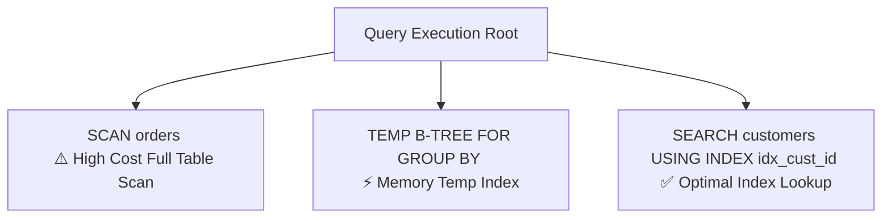

Slow mobile database queries drain battery and cause UI frame drops. VetroLog's **Visual Query Plan** transforms cryptic SQLite `EXPLAIN QUERY PLAN` logs into an intuitive, visual tree structure.

---

## 🔍 Why Visual Query Plans Matter on Mobile

Running `EXPLAIN QUERY PLAN` natively in SQLite returns raw, hard-to-read tabular text:

```text
0|0|0|SCAN TABLE orders
0|0|0|USE TEMP B-TREE FOR GROUP BY
0|1|1|SEARCH TABLE customers USING INDEX idx_cust_id (id=?)
```

VetroLog parses these records into a **hierarchical DAG (Directed Acyclic Graph)**, assigning cost categories and visual alerts to every operation node.



---

## 🎨 Visual Cost Alert Categories

Each node in the query plan tree is highlighted with a clear status indicator:

| Alert | Node Type | Meaning & Performance Impact |
| :--- | :--- | :--- |
| 🔴 **High Cost Alert** | `SCAN <table_name>` | **Full Table Scan**: SQLite is iterating through every single row in the table because no usable index exists. Causes major lag on large tables! |
| 🟡 **Warning Alert** | `TEMP B-TREE` | **Temporary B-Tree**: SQLite created an in-memory B-Tree to satisfy an `ORDER BY` or `GROUP BY` clause. Consumes memory and CPU cycles. |
| 🟢 **Optimal** | `SEARCH <table_name> USING INDEX` | **Index Lookup**: SQLite accessed records directly via a B-Tree index in $O(\log N)$ time. Ideal performance. |
| 🔵 **Info** | `COMPOUND / SUBQUERY` | Correlated or uncorrelated subquery execution branch. |

---

## 🚀 How to Inspect a Query Plan

1. Enter your SQL query in the **SQL Playground**.
2. Click the **Explain Plan** button (or switch to the **Visual Plan** tab in the bottom panel).
3. VetroLog renders the step-by-step operator hierarchy.


4. If a `SCAN` node is detected, click on the **[1-Click Index Advisor](/vetrolog/index-advisor/)** to instantly generate the missing index!

---

## Next Steps

* Use the **[1-Click Index Advisor](/vetrolog/index-advisor/)** to fix slow `SCAN` queries with optimal indexes.
* Check query latency against the 60 FPS mobile budget in the **[Performance Profiler](/vetrolog/profiler-and-dryrun/)**.
