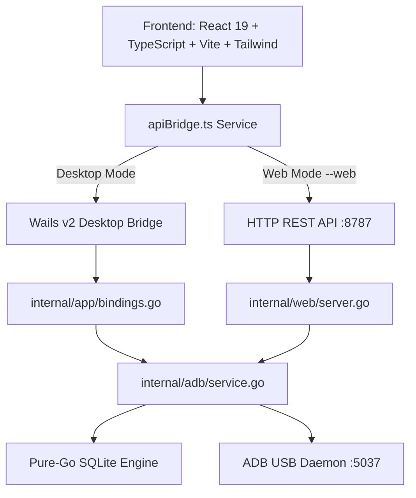

# VetroLog Architecture & Internal Logic

> **Written in Plain English**: A deep dive into how VetroLog inspects, synchronizes, and mutates mobile databases over USB without touching a single line of your mobile application code.

---

## 1. The Core Philosophy: "Zero-Code" Inspection

Most mobile debugging tools (such as Facebook Flipper, Stetho, or custom debug drawers) require developers to:
1. Add third-party packages to `pubspec.yaml` or `build.gradle`.
2. Initialize debug listeners inside `main.dart` or `Application.kt`.
3. Recompile and redeploy the app.
4. Remember to strip out the debug code before publishing to Google Play or the App Store.

**VetroLog takes a radically different approach:**

```
┌───────────────────────────────────────┐
│        Your Flutter / Android App     │
│  (100% Clean Code - No SDK Installed) │
└───────────────────┬───────────────────┘
                    │  Local SQLite Sandbox (/data/data/<pkg>/databases)
                    ▼
┌───────────────────────────────────────┐
│         Android OS Security           │
│   (Allows 'run-as' for debug builds)  │
└───────────────────┬───────────────────┘
                    │  ADB Daemon (Port 5037 over USB)
                    ▼
┌───────────────────────────────────────┐
│         VetroLog Desktop / Web        │
│   (Live Inspection, Queries & Edits)  │
└───────────────────────────────────────┘
```

By leveraging the Android operating system's built-in developer bridges, VetroLog treats your phone's database files as a live data store, leaving your mobile codebase pristine and release-ready.

---

## 2. How ADB Zero-Code Discovery Works

When your physical phone or emulator is plugged into your computer via USB:

### A. Communicating with the ADB Server
VetroLog's Go backend communicates directly with the local **Android Debug Bridge daemon** (`adb server`, listening on `127.0.0.1:5037`).
- It executes `adb devices -l` to enumerate all attached physical devices, Android TVs, and emulators.
- It parses device attributes: device model, hardware product ID, transport ID, and online state.

### B. Finding Running Debuggable Apps
To avoid scanning through hundreds of system bloatware apps:
1. VetroLog runs a single, lightning-fast bash subshell command on the phone:
   ```bash
   for p in $(pm list packages -3 | cut -d: -f2); do
     if run-as $p id >/dev/null 2>&1; then
       pid=$(pidof $p 2>/dev/null);
       if [ -n "$pid" ]; then
         echo "RUNNING:$p:$pid";
       fi;
     fi;
   done
   ```
2. **`run-as $p id`**: Android’s Linux kernel prevents regular users from reading another app’s private `/data/data/<package>` sandbox. However, if an app was built in debug mode (`android:debuggable="true"`, standard during `flutter run`), the kernel grants permission to run commands inside that app's Linux user ID!
3. **`pidof $p`**: Checks if the process is currently alive in memory. Apps with an active process ID are flagged with `(Running)` or `(Active)`, allowing VetroLog to prioritize the app you are currently coding.

---

## 3. Real-Time SQLite WAL & SHM Synchronization

Modern mobile databases (like Flutter's `sqflite`, Android Room, or standard SQLite) do not write directly to the primary `.db` file on every single insert or update. Instead, they use **WAL Mode (Write-Ahead Logging)** for high concurrency:

```
App Database Files on Device:
├── app_database.db          <-- Base SQLite schema and older data
├── app_database.db-wal      <-- Write-Ahead Log: Newly inserted/updated uncommitted rows
└── app_database.db-shm      <-- Shared Memory index coordinating active locks
```

### The Challenge
If a tool only copies `app_database.db`, it will display **stale, outdated data** because the newest records still live inside `app_database.db-wal`!

### How VetroLog Solves This
1. **Tri-File Sync**: Whenever VetroLog inspects a database, it checks and synchronizes the base `.db` file, the `-wal` file, and the `-shm` file simultaneously:
   ```bash
   adb exec-out run-as <pkg> cat databases/app.db > cache/app.db
   adb exec-out run-as <pkg> cat databases/app.db-wal > cache/app.db-wal
   adb exec-out run-as <pkg> cat databases/app.db-shm > cache/app.db-shm
   ```
2. **Zero Mobile Locking**: Using standard Unix stdout streaming (`exec-out cat`), VetroLog never holds a file lock on the phone. Your Flutter app continues reading and writing to its database without experiencing `database locked` exceptions.
3. **Delta Detection**: VetroLog compares remote file sizes and timestamps. If the `-wal` file size has changed (indicating new rows were inserted by the mobile app), VetroLog updates its local cache and automatically signals the frontend to refresh the active table view.

---

## 4. In-Memory Pure-Go SQLite Engine

Instead of relying on heavy C libraries (`cgo`) that make cross-platform compilation difficult, VetroLog uses **modernc.org/sqlite** — a 100% pure Go SQLite engine compiled directly from SQLite's official C source via `ccgo`.

### Execution Flow:
1. **Schema Discovery**: When an app is selected, VetroLog reads `sqlite_master` to extract:
   - All table names (ignoring internal tables like `android_metadata` and `sqlite_sequence`).
   - Primary key definitions.
   - Column names and data types (`INTEGER`, `TEXT`, `REAL`, `BLOB`).
   - Live row count estimates.
2. **Query Runner**: When you type a query in the SQL editor:
   - VetroLog executes the SQL query against the synced SQLite database.
   - Measures the exact execution duration down to microseconds (`durationMs`).
   - Returns structured column names and row arrays ready for the DataGrid.
3. **Mutation Write-Back**:
   When you edit a cell or execute an `UPDATE`/`DELETE` query:
   - VetroLog commits the change locally.
   - Pipes the updated SQLite bytes back into the phone's sandbox:
     ```bash
     cat <localCache> | adb shell run-as <pkg> sh -c 'cat > databases/<dbName>'
     ```
   - Your mobile app immediately sees the edited data on its next database read!

---

## 5. Dual Engine Architecture: Desktop & Web

VetroLog is engineered to run as both a **Native Desktop App** and a **Local Web Server** using a single unified codebase:



### The `apiBridge.ts` Adapter
The frontend dynamically detects its runtime environment:
```typescript
export const isWailsApp = (): boolean => {
  return typeof window !== 'undefined' && 'go' in window && Boolean((window as any).go?.app?.App);
};
```
- In **Desktop mode**: Calls native Wails binary bindings (`window.go.app.App.*`) for maximum desktop integration.
- In **Web mode**: Dispatches standard `fetch('/api/adb/*')` requests to the embedded Go HTTP server.
- The React components and state stores (`useAdbStore.ts`, `useDatabaseStore.ts`) are **100% shared** across both platforms with zero duplicate logic.
