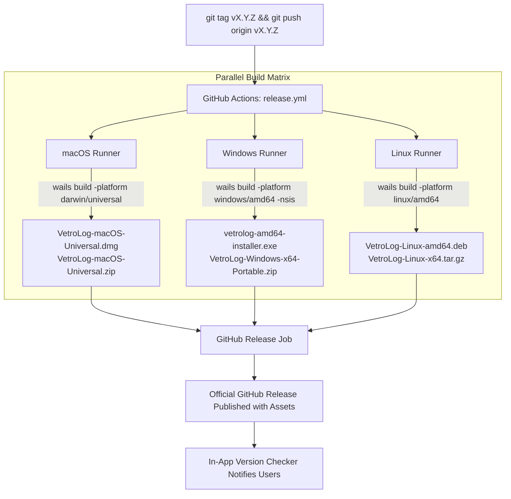

# VetroLog Deployment & Release Guide

This document describes the automated deployment and release pipeline for VetroLog. It explains how to publish new multi-platform releases, how the GitHub Actions CI/CD matrix operates, and how the in-app update notification system works.

---

## 1. Overview of the Release Pipeline

VetroLog uses **GitHub Actions** to automate cross-platform binary compilation and release packaging. Whenever a semantic version tag (e.g. `v1.1.0`) is pushed to GitHub, the CI/CD pipeline triggers:



---

## 2. Step-by-Step: Publishing a New Release

### Step 1: Update the Version Constants
Before tagging a release, update the version number in these files:

1. **`frontend/src/features/updater/useUpdateChecker.ts`**:
   ```typescript
   export const CURRENT_VERSION = 'v1.1.0'; // Bump to new version
   ```
2. **`package.json`** / **`wails.json`**:
   Ensure metadata reflects the new version if needed.

### Step 2: Commit and Push Changes to `main`
```bash
git add -A
git commit -m "chore: bump version to v1.1.0"
git push origin main
```

### Step 3: Create and Push the Git Tag
Create an annotated Git tag and push it to GitHub:
```bash
# Create annotated tag
git tag -a v1.1.0 -m "Release v1.1.0: Real-time WAL sync and web server mode"

# Push tag to GitHub
git push origin v1.1.0
```

---

## 3. What GitHub Actions Does Automatically

Once the tag is pushed, [`.github/workflows/release.yml`](file:///Users/md.tanvirulislam/Desktop/vetrolog/.github/workflows/release.yml) automatically executes:

### A. macOS Universal Build (`macos-latest`)
- Sets up Go (using version defined in `go.mod`) and Node.js 20.
- Installs Wails CLI v2.
- Runs `wails build -platform darwin/universal -clean`.
  - Produces a fat binary containing slices for both **Apple Silicon (M1/M2/M3/M4)** and **Intel x86_64**.
- Uses `ditto` to generate `VetroLog-macOS-Universal.zip`.
- Uses `create-dmg` to generate the drag-and-drop installer `VetroLog-macOS-Universal.dmg`.

### B. Windows Build (`windows-latest`)
- Runs `wails build -platform windows/amd64 -clean -nsis`.
- Generates:
  - Guided setup wizard: `vetrolog-amd64-installer.exe`.
  - Standalone portable archive: `VetroLog-Windows-x64-Portable.zip`.

### C. Linux Build (`ubuntu-22.04`)
- Installs `libgtk-3-dev`, `libwebkit2gtk-4.0-dev`, and `libwebkit2gtk-4.1-dev`.
- Runs `wails build -platform linux/amd64 -clean`.
- Packages:
  - Portable tarball: `VetroLog-Linux-x64.tar.gz`.
  - Debian/Ubuntu `.deb` installer: `VetroLog-Linux-amd64.deb` with desktop entry and 512x512 app icon.

### D. Automated Release Publishing
The `release` job collects all six artifacts and publishes an official GitHub Release at:
`https://github.com/Tanvirul-swe/vetrolog/releases/tag/vX.Y.Z` with release notes automatically generated from commit logs.

---

## 4. In-App Update Notification Mechanics

VetroLog includes a lightweight client-side update checker ([`useUpdateChecker.ts`](file:///Users/md.tanvirulislam/Desktop/vetrolog/frontend/src/features/updater/useUpdateChecker.ts)):

1. On launch, the frontend queries:
   ```http
   GET https://api.github.com/repos/Tanvirul-swe/vetrolog/releases/latest
   ```
2. It parses the latest published `tag_name` (e.g. `v1.2.0`) and compares it against `CURRENT_VERSION` using semantic version parsing (`v1.2.0 > v1.1.0`).
3. If an update is detected, the top header badge ([`UpdateBadge.tsx`](file:///Users/md.tanvirulislam/Desktop/vetrolog/frontend/src/features/updater/UpdateBadge.tsx)) pulses with an amber indicator:
   ```
   [ ✨ Update v1.2.0 ↗ ]
   ```
4. Clicking the badge opens the GitHub Releases download page directly in the user's default browser.

---

## 5. Troubleshooting & Operations

### How to re-trigger a failed release tag
If a release build failed due to a transient GitHub Actions infrastructure issue:
```bash
# 1. Delete the local tag
git tag -d v1.1.0

# 2. Delete the remote tag on GitHub
git push origin :refs/tags/v1.1.0

# 3. Fix the issue, commit, and re-tag
git tag -a v1.1.0 -m "Release v1.1.0"
git push origin v1.1.0
```

### Manual Trigger via GitHub UI
The workflow also includes `workflow_dispatch`, meaning you can trigger a build manually from your browser by visiting:
`https://github.com/Tanvirul-swe/vetrolog/actions/workflows/release.yml` and clicking **"Run workflow"**.
