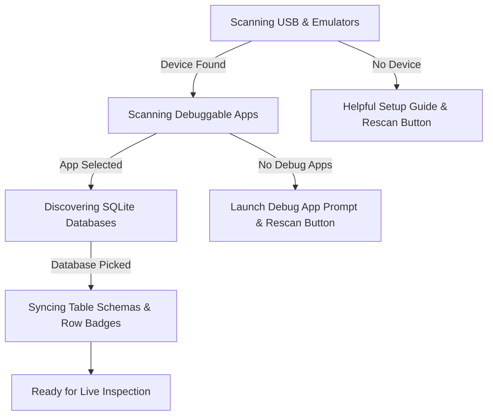
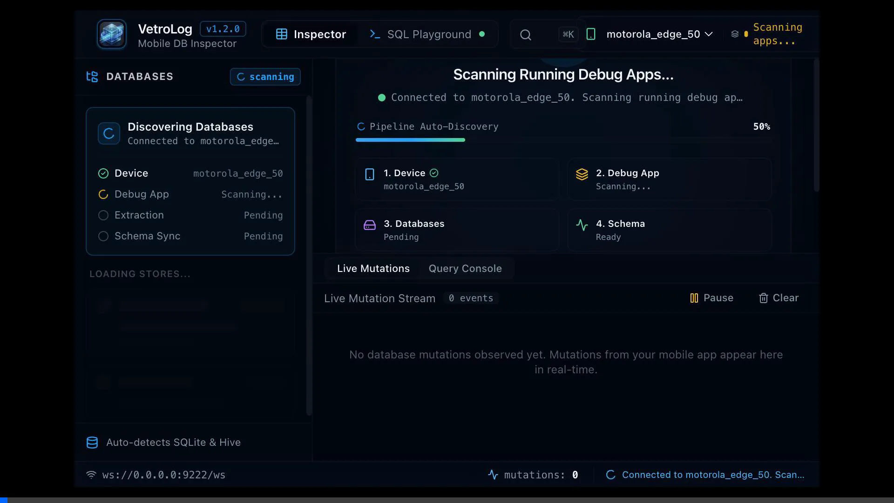

# ADB Device & App Discovery

VetroLog features an intelligent background discovery pipeline that monitors connected Android devices and debuggable applications without user intervention.

---

## 🔌 Discovery State Machine

When VetroLog starts, its internal discovery engine runs through an automated 4-stage pipeline:

---

## 🎬 Discovery in Action

---

### 1. Device Detection (`scanning_devices`)
* VetroLog queries `adb devices -l` every 3 seconds in the background.
* Detects physical phones over USB, wireless ADB (`ip:5555`), and local emulators (`emulator-5554`).
* Extracts readable model names (such as `motorola_edge_50` or `Pixel_7_Pro_API_34`) and hardware transport IDs.

### 2. App Package Detection (`scanning_apps`)
* Automatically scans third-party packages installed on the selected device.
* Filters strictly for debuggable packages (`android:debuggable="true"`).
* Uses `dumpsys activity activities` to identify which app is currently focused in the foreground and marks it with an **`(Active)`** tag for instant 1-click selection.

### 3. Database Discovery (`discovering_databases`)
* Executes non-invasive `run-as <package>` commands inside the app's private sandbox.
* Discovers:
  * Standard SQLite databases in `databases/`
  * Flutter sqflite files in `app_flutter/`
  * Android XML preferences in `shared_prefs/`

### 4. Table Schema Synchronization (`loading_schema`)
* Fetches table metadata: column names, SQLite data types (`INTEGER`, `TEXT`, `REAL`, `BLOB`), primary keys (`PK`), foreign key relations, and record counts.

---

## 📱 Switching Between Multiple Devices

If you have multiple devices connected (e.g. a physical phone and an emulator simultaneously):

1. Click on the **Device Selector** in the top header.
2. Choose your desired device from the list.
3. VetroLog immediately transitions to the new device and rescans its debuggable packages without restarting the application.

---

## 🔄 Graceful Hot-Unplug & Recovery

If you unplug your USB cable while inspecting a database:
* VetroLog detects device disconnection instantly.
* The UI transitions into a clean disconnected state with clear guidance.
* As soon as you plug the device back in, VetroLog automatically restores connection and resyncs your active table.

---

## Next Steps

* Discover how the **[Live Table Inspector](live-inspector.md)** renders and filters database records.
* Learn how **[Real-Time WAL Sync](wal-realtime-sync.md)** updates changes on the fly.
