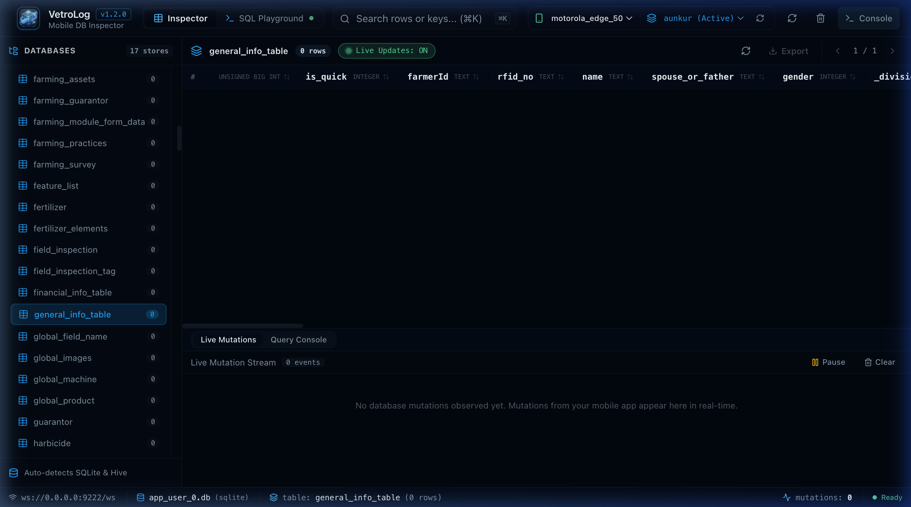

# Web Server Mode (Headless & Remote Inspection)

While VetroLog defaults to a native desktop window (via Wails v2), it also includes an embedded **HTTP Web Server mode**.

This allows you to inspect mobile databases directly in **Google Chrome, Safari, Firefox, or Edge**, or run VetroLog on a remote headless machine, Docker container, or CI/CD test environment.



---

## 🌐 Launching Web Server Mode

You can launch Web Server mode using either the `--web` flag or the `serve` command:

```bash
# Standard launch (auto-opens http://localhost:8787 in your default browser)
./vetrolog --web

# Or use the serve command
./vetrolog serve
```

---

## 🛠️ Configuration Flags

### Custom Port
By default, VetroLog binds to port `8787`. You can customize the listening port:
```bash
./vetrolog --web --port 9090
```

### Headless Mode (Disable Auto-Opening Browser)
If you are running VetroLog via an SSH terminal or background script:
```bash
./vetrolog --web --no-browser
```

---

## 🖥️ Remote Inspection over Local Network or SSH Tunnel

If your Android device is connected to a remote office machine or continuous testing workstation, you can inspect it from your personal laptop:

### Option A: SSH Port Forwarding
```bash
# Forward port 8787 from the remote machine to your local laptop
ssh -L 8787:localhost:8787 developer@remote-workstation

# On the remote machine:
./vetrolog --web --no-browser
```
Now, open **`http://localhost:8787`** on your laptop!

### Option B: Local Network Binding
Run VetroLog on the host machine and access it from any browser on the same Wi-Fi / LAN by navigating to `http://<host-ip>:8787`.

---

## 🏗️ Architecture Under the Hood

In Web Server mode:
1. Go starts an embedded HTTP server using `net/http`.
2. Serves the pre-compiled React 19 single-page application from `frontend/dist`.
3. Exposes REST endpoints (`/api/adb/devices`, `/api/adb/apps`, `/api/adb/databases`, `/api/adb/query`).
4. The client-side `apiBridge.ts` automatically detects the browser environment (`isWailsApp() === false`) and transparently routes all requests through the HTTP REST API instead of Wails desktop IPC!

---

## Next Steps

* View all command-line arguments in the **[CLI Reference](cli-reference.md)**.
* Learn how automated builds work in **[CI/CD & Releases](ci-cd-releases.md)**.
