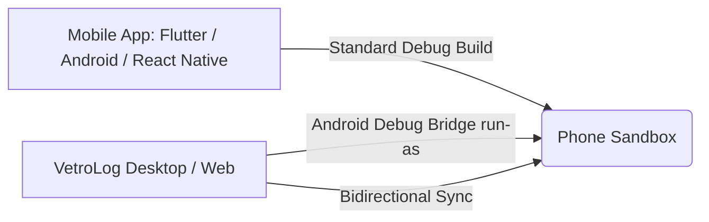

# What is VetroLog?

Mobile database debugging has historically been painful. Traditional inspection approaches force developers into frustrating compromises:

1. **Third-Party SDK Overhead**: Tools like Facebook Flipper or Chrome Stetho require adding heavy dependencies into your mobile app, configuring network listeners, and risking leaks in production builds.
2. **Manual Device Pulls**: Using `adb exec-out run-as <package> cat databases/... > local.db` requires repeating command-line scripts, breaks whenever WAL files change, and cannot write edits back to the device.
3. **Emulator Only Limitations**: Many desktop database viewers only work with rooted emulators or unencrypted file systems.

---

## 🎯 The VetroLog Philosophy: Zero Code, True Live Inspection

VetroLog was built to eliminate these hurdles. It operates on three core principles:

### 1. Zero Code Modification
You do not need to install an SDK or write a single line of boilerplate. VetroLog leverages Android's secure `run-as` mechanism over ADB, allowing it to inspect any debuggable application (`android:debuggable="true"`).

### 2. Native Multi-Platform Desktop & Web Core
Built with **Go 1.26** on the backend and **React 19 / TypeScript** on the frontend via **Wails v2**, VetroLog runs as an ultra-fast, lightweight native desktop app on macOS, Windows, and Linux, and can also run in standalone Web Server mode (`./vetrolog --web`).

### 3. Active Real-Time Write-Ahead Log (WAL) Monitoring
SQLite modern mobile applications use WAL mode (`-wal` and `-shm` files). When your mobile app executes an insert or update query on your phone, VetroLog automatically detects the file timestamp change and updates your screen in real time.

---

## 📊 Feature Comparison Matrix

| Capability | VetroLog | Stetho | Flipper | DB Browser for SQLite |
| :--- | :---: | :---: | :---: | :---: |
| **Zero App Code Required** | ✅ Yes | ❌ No (SDK required) | ❌ No (Plugin required) | ✅ Yes |
| **Real-Time WAL Auto-Sync** | ✅ Yes | ❌ No | ⚠️ Partial | ❌ No (Static file) |
| **Bidirectional In-line Editing** | ✅ Yes | ⚠️ Read-mostly | ⚠️ Read-mostly | ❌ Offline only |
| **Visual EXPLAIN Plan Tree** | ✅ Yes | ❌ No | ❌ No | ⚠️ Raw text |
| **Natural Language AI (Gemini 2.5)** | ✅ Yes | ❌ No | ❌ No | ❌ No |
| **Mobile 60 FPS Profiler** | ✅ Yes | ❌ No | ❌ No | ❌ No |
| **Safe Transaction Dry-Run** | ✅ Yes | ❌ No | ❌ No | ❌ No |
| **Multi-Platform Code Generator** | ✅ Yes | ❌ No | ❌ No | ❌ No |
| **Native macOS, Win, Linux & Web** | ✅ Yes | ❌ Chrome only | ⚠️ Electron | ⚠️ Desktop only |

---

## Next Steps

* Ready to install VetroLog? Check out the **[Installation Guide](installation.md)**.
* Have VetroLog installed already? Jump directly to the **[3-Minute Quick Start](quickstart.md)**.
