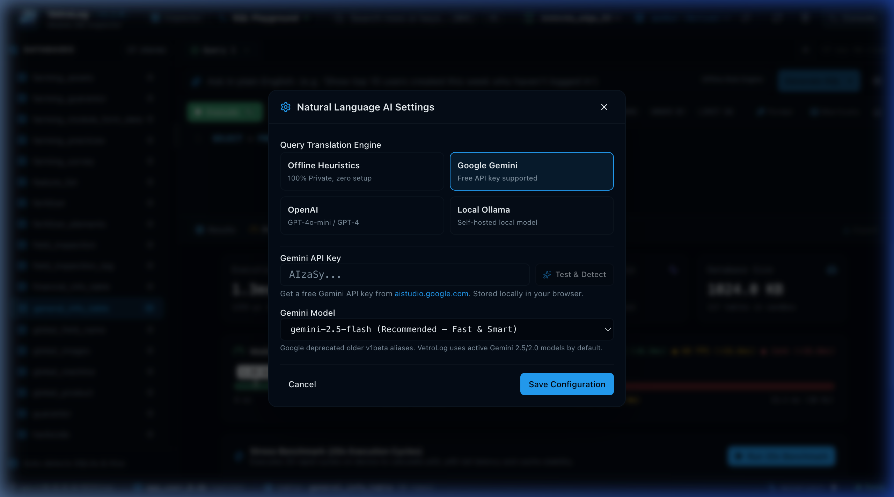

# Natural Language to SQL (Gemini 2.5 Flash & BYOK AI)

Write complex SQLite queries in plain English without memorizing syntax or column names.

---

---

## 🎬 AI Generation & Safe Dry-Run Demo

---

## ⚡ How It Works: Schema Context Injection

When you enter a natural language request (such as *"Show top 10 farmers in Rangpur who registered this month with their farming practices"*), VetroLog:

1. **Extracts Live Schema**: Automatically compiles table definitions, column types, primary keys, and foreign keys from the active database.
2. **Constructs System Prompt**: Injects the schema as SQLite DDL (`CREATE TABLE ...`) into a specialized database engineer prompt.
3. **Generates SQLite Dialect**: Enforces strict SQLite dialect constraints and outputs clean, performant SQL.
4. **1-Click Execution**: Presents the generated SQL in your editor with a **Run Now** button.

---

## 🤖 Supported AI Providers

Click the **Gear icon (⚙️)** in the natural language bar to open **AI Settings**:

### 1. Google Gemini (Recommended)
* **Default Model**: **`gemini-2.5-flash`** (High-speed, intelligent reasoning model).
* **Free API Key**: Supports free API keys from [Google AI Studio](https://aistudio.google.com/app/apikey).
* **Test & Detect**: Click the **"Test & Detect"** button to instantly validate your key and populate the model dropdown with all active models available on your Google Cloud account.
* **Self-Healing Fallback**: If an older model name is encountered, VetroLog automatically queries the Gemini API and transitions to an active generation model seamlessly.

### 2. OpenAI
* **Models**: `gpt-4o-mini` (Recommended for cost/speed), `gpt-4o`, `gpt-4-turbo`.
* Requires an OpenAI API key from [platform.openai.com](https://platform.openai.com).

### 3. Local Ollama (100% Offline & Private)
* **Self-Hosted**: Connect to your local Ollama instance (default: `http://localhost:11434`).
* **Models**: `codellama`, `llama3`, `deepseek-coder`, `mistral`.
* **Zero Internet**: All prompts and schema stay strictly on your local computer.

### 4. Offline Heuristics Engine
* Built-in rule-based parser that handles basic queries (`SELECT`, `WHERE`, `COUNT`, `LIMIT`, `ORDER BY`) with **zero setup and zero API keys**.

---

## 🔒 Privacy & API Key Security


**Local Security**: All API keys are stored strictly in your browser's local storage (`localStorage`). They are never collected by VetroLog's developers or sent to any intermediary telemetry servers. Requests travel directly between your machine and the selected AI provider.


---

## 💡 Example Prompts to Try

* *"Show the 5 newest farmers who registered this month"*
* *"Find all farming practices with plot size greater than 2 acres and join with farmer info"*
* *"Count how many records each table has and group by district"*
* *"Find duplicate phone numbers across all farmers"*

---

## Next Steps

* Optimize your generated queries using the **[1-Click Index Advisor](index-advisor.md)**.
* Check frame budgets in the **[Performance Profiler & Safe Dry-Run](profiler-and-dryrun.md)**.
